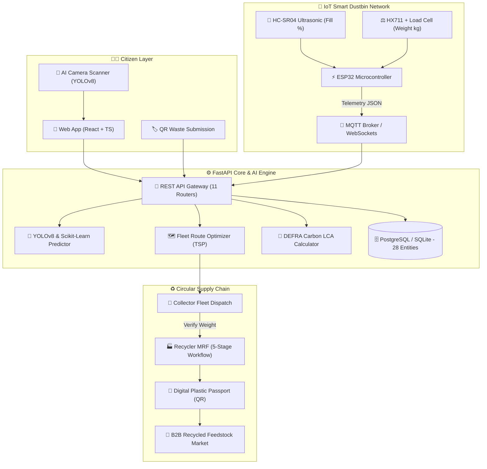

<div align="center">

# 🌿 ECOTRACE 360
### Every Waste Has a Journey. Every Plastic Has a Future.
**AI-Powered Smart Waste Management, IoT Sensor Mesh & Circular Plastic Recycling Traceability Platform**

[](https://dev-kaushikpraveen.github.io/waste-management/)
[](https://vercel.com/new/clone?repository-url=https%3A%2F%2Fgithub.com%2Fdev-kaushikpraveen%2Fwaste-management&root-directory=frontend)
[](http://localhost:8001/docs)
[](LICENSE)

<br/>

[](https://react.dev)
[](https://vitejs.dev)
[](https://tailwindcss.com)
[](https://fastapi.tiangolo.com)
[](https://pytorch.org)
[](https://espressif.com)
[](https://mqtt.org)
[](https://docker.com)

---

### 🔗 Quick Navigation & Live Deployment Links

| Resource | URL Link | Description |
| :--- | :--- | :--- |
| 🌐 **Live Web Application** | **[https://dev-kaushikpraveen.github.io/waste-management/](https://dev-kaushikpraveen.github.io/waste-management/)** | Production-ready Saahas Zero Waste light UI portal |
| 🚀 **1-Click Vercel Deploy** | **[Deploy on Vercel](https://vercel.com/new/clone?repository-url=https%3A%2F%2Fgithub.com%2Fdev-kaushikpraveen%2Fwaste-management&root-directory=frontend)** | Deploy frontend to Vercel in 60 seconds with zero config |
| ⚙️ **Interactive Swagger API** | **[http://localhost:8001/docs](http://localhost:8001/docs)** | OpenAPI 3.0 specification & live interactive test console |
| 📡 **IoT Telemetry Endpoint** | **`http://localhost:8001/api/iot/telemetry`** | ESP32 Ultrasonic & Load-Cell ingestion webhook |
| 📦 **GitHub Repository** | **[dev-kaushikpraveen/waste-management](https://github.com/dev-kaushikpraveen/waste-management)** | Source code, firmware, documentation & assets |

---

</div>

## 📖 Executive Summary & Vision

India generates over **3.4 Million Tonnes of plastic waste every year**, of which approximately **40% remains uncollected**, choking municipal storm drains, poisoning marine ecosystems, and releasing hazardous carcinogenic dioxins through open combustion. Furthermore, the lack of transparency prevents corporate brand owners from meeting mandatory **CPCB Extended Producer Responsibility (EPR)** compliance under the **Plastic Waste Management (PWM) Rules 2016 (Amended 2022)**.

**ECOTRACE 360** resolves this crisis through an end-to-end, integrated circular intelligence ecosystem combining:
1. **Edge Computer Vision (YOLOv8)** for automated polymer classification.
2. **IoT Ultrasonic & Strain-Gauge Hardware** for real-time smart dustbin fill and weight monitoring.
3. **Cryptographically Traceable Digital Plastic Passports** with QR codes tracking material from citizen disposal to certified recycled rPET pellets.
4. **Traveling Salesperson (TSP) Collection Route Optimization** minimizing vehicle fuel emissions.
5. **Gamification & Rewards Engine** incentivizing citizen segregation.
6. **B2B Circular Feedstock Marketplace** connecting certified recyclers with packaging manufacturers.

---

## 🏛️ System Architecture



---

## 🎯 12 Integrated Functional Modules

| # | Module | Core Functionality | Tech Applied |
| :-: | :--- | :--- | :--- |
| **01** | **AI Waste Classifier** | Real-time object recognition (PET, HDPE, Glass, Metal, Cardboard) with confidence scoring & CPCB disposal guide | YOLOv8, PyTorch, Canvas Confetti |
| **02** | **IoT Smart Bins Radar** | Live municipal radar map with dynamic ultrasonic fill % gauges, load cell weight & battery health telemetry | Leaflet, OpenStreetMap, MQTT, ESP32 |
| **03** | **Digital Plastic Passport** | Unique QR identity per collected batch (`ECO-PET-2026-XXXXXX`) documenting immutable chain-of-custody | QRCode Engine, Cryptographic Audit Trail |
| **04** | **Public Tracking Portal** | Publicly verifiable web ledger allowing consumers & auditors to inspect polymer origin and recycling history | Open Web Ledger, ISO 14021 Standard |
| **05** | **Route Optimizer** | Traveling Salesperson Problem (TSP) heuristic sequencing stops to prioritize overflow bins & reduce EV miles | TSP Algorithm, Haversine Distance |
| **06** | **MRF 5-Stage Pipeline** | Recycler facility pipeline: Received ➔ Sorted ➔ Hot Wash & Shred ➔ Extrusion ➔ Circular Complete | Mass Balance Reconciliation, CPCB Form IV |
| **07** | **Rewards Wallet** | Verified deposits award Green Points redeemable for partner merchant vouchers, credits & eco kits | Tiered Gamification, Canvas Confetti |
| **08** | **District Leaderboard** | Real-time ranking of municipal zones and verified citizen eco-champions based on cumulative diverted kilograms | Aggregate Analytics, Real-time Sorting |
| **09** | **B2B Feedstock Market** | B2B trading catalog for certified Grade-A rPET flakes, HDPE granules, and post-consumer resins | Order Lifecycle, Stock Reservation |
| **10** | **Carbon LCA Analytics** | Quantified environmental impact: CO₂ abated (kg), tree sequestration equivalents & landfill diversion (m³) | DEFRA Emission Factors, Recharts Visuals |
| **11** | **Pickup Booking** | On-demand doorstep collection request with preferred time slot and category selection | Reactive Web Forms, Geo-tagging |
| **12** | **Sanitation Grievances** | Photo & GPS-tagged incident reporting for unattended waste heaps, overflowing bins or open burning | Geo-location, Dispatch Priority Queue |

---

## 👥 User Roles & Evaluator Credentials

The platform enforces **Role-Based Access Control (RBAC)** across 5 roles:

| Role | Demo Email | Password | Primary Dashboard & Capabilities |
| :--- | :--- | :--- | :--- |
| 🧑‍🎓 **Citizen** | `citizen@ecotrace.org` | `EcoCitizen2026!` | AI camera scan, book doorstep pickup, view green points wallet & leaderboard |
| 🚚 **Collector** | `collector@ecotrace.org` | `EcoCollector2026!` | TSP optimal navigation sequence, bin overflow verification, weight logging |
| 🏭 **Recycler** | `recycler@ecotrace.org` | `EcoRecycler2026!` | MRF material acceptance, 5-stage transformation, issue recycled pellet passport |
| 🏛️ **Admin** | `admin@ecotrace.org` | `EcoAdmin2026!` | Smart city central command, IoT sensor alarm monitoring, truck dispatching |
| 👑 **Super Admin** | `superadmin@ecotrace.org` | `EcoSuperAdmin2026!` | Full platform configuration, system parameters, audit security logs |

> ⚡ **Quick Evaluator Feature:** On the [Login Page](http://localhost:3000/login), single-click quick buttons automatically fill and authenticate any role instantly!

---

## 🔌 Hardware Circuit & IoT Firmware

The smart dustbin hardware layer is built on the **ESP32 DevKit v1**:

| Sensor / Module | Purpose | Interface Pin on ESP32 |
| :--- | :--- | :--- |
| **HC-SR04** (Ultrasonic) | Measure distance to waste surface (Fill % calculation) | `TRIG: GPIO 5`, `ECHO: GPIO 18` |
| **HX711 + 50kg Load Cell** | Real-time mass measurement of deposited waste | `DT: GPIO 21`, `SCK: GPIO 22` |
| **Status RGB LED** | Local bin status indicator (Green/Yellow/Red) | `R: GPIO 25`, `G: GPIO 26`, `B: GPIO 27` |
| **Piezo Buzzer** | Audible overflow / maintenance alarm | `BUZZER: GPIO 14` |
| **Wi-Fi + MQTT** | Telemetry packet transmission (10-second interval) | Native 2.4GHz 802.11 b/g/n |

Firmware source: `iot/firmware/esp32_smart_bin.ino`  
Wiring diagram schematic: `iot/wiring_diagram.md`

### 💻 Running the IoT Telemetry Simulator:
If testing without physical ESP32 hardware, run the multi-bin telemetry simulator:
```bash
# Transmit live telemetry for 5 bins over 5 cycles
./venv/bin/python3 mqtt_bin_simulator.py 5
```

---

## 🚀 Installation & Local Development

### 1. Clone the Repository
```bash
git clone https://github.com/dev-kaushikpraveen/waste-management.git
cd waste-management
```

### 2. Backend Setup
```bash
# Create and activate python virtualenv
python3 -m venv venv
source venv/bin/activate

# Install dependencies
pip install -r backend/requirements.txt

# Run automated test suite
cd backend && PYTHONPATH=. pytest tests/test_full_lifecycle.py -v

# Start FastAPI server on port 8001
PYTHONPATH=. uvicorn app.main:app --host 0.0.0.0 --port 8001 --reload
```
API Documentation will be live at: **`http://localhost:8001/docs`**

### 3. Frontend Setup
```bash
cd frontend

# Install node modules
npm install

# Build production bundle
npm run build

# Start Vite dev server on port 3000
npm run dev -- --port 3000
```
Web App will be live at: **`http://localhost:3000`**

### 4. Docker All-in-One Deployment
```bash
docker-compose up --build -d
```

---

## 📜 Regulatory Standards Compliance

EcoTrace 360 aligns with key circular economy frameworks:
- **India Plastic Waste Management (PWM) Rules 2016 (Amended 2022)**
- **Central Pollution Control Board (CPCB) EPR Form IV Guidelines**
- **ISO 14021 Environmental Labels and Claims**
- **DEFRA Life-Cycle Assessment (LCA) Carbon Accounting Model**

---

## 👥 Contributors & Acknowledgements

- **Lead Architect & Developer**: Praveen Kaushik ([@dev-kaushikpraveen](https://github.com/dev-kaushikpraveen))
- Inspired by the clean, corporate sustainability principles of **Saahas Zero Waste**.

---

<div align="center">
  <sub>Built with ❤️ for a cleaner, greener, zero-waste planet.</sub>
</div>
