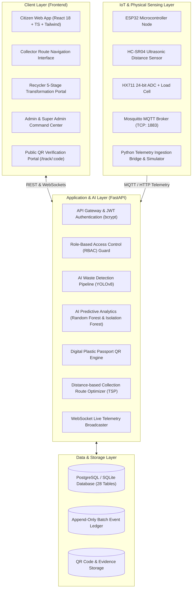

# EcoTrace 360 - System Architecture Specification

## 1. System Vision & Value Proposition

**EcoTrace 360** is an enterprise-grade smart-city waste management and plastic recycling traceability platform. It integrates Edge AI computer vision, IoT telemetry, Digital Plastic Passports, and a transparent immutable audit trail to bridge the gap between waste generation and certified recycling.

---

## 2. Multi-Tier High-Level Architecture

---

## 3. Core Software Modules (12 Modules)

1. **Citizen Portal**: AI waste scanner, nearby smart bins map, green points wallet, pickup scheduling, and community competitions.
2. **AI Waste Classification**: YOLO-based classification with bounding box coordinates, confidence scoring, and disposal instructions.
3. **IoT Smart Bin Monitoring**: Live ultrasonic fill percentage, load cell weight measurements, battery level, and overflow alarms.
4. **Digital Plastic Passport**: Unique QR-coded identifiers (`ECO-PET-2026-XXXXXX`) logging immutable custody transitions.
5. **Smart Waste Collection**: Distance-optimized collection sequences and pickup status updates.
6. **Recycler Portal**: 5-stage processing flow (Inspection $\rightarrow$ Sorting $\rightarrow$ Washing $\rightarrow$ Shredding $\rightarrow$ Pelletizing).
7. **Green Rewards & Gamification**: Verified transaction ledger, leaderboards (Individual, Hostel, College), and campus vouchers.
8. **AI Waste Prediction**: Random Forest regression forecasting area waste volumes and bin overflow probabilities.
9. **Recycling Marketplace**: B2B platform connecting recyclers with packaging manufacturers.
10. **Environmental Impact Analytics**: Quantified CO₂ abated, trees saved, and landfill volume avoided.
11. **Citizen Complaint Portal**: Geotagged illegal dumping and damaged bin reports.
12. **Admin Command Center**: Centralized KPIs, sensor health monitoring, and municipal dispatch controls.
