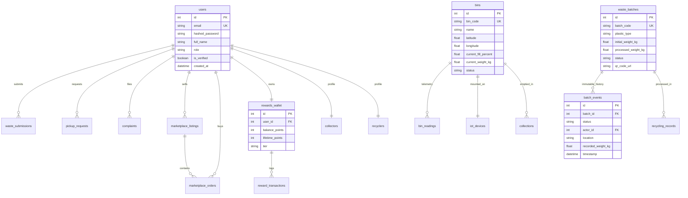

# EcoTrace 360 - Database Entity Relationship (ER) Documentation

The EcoTrace 360 database is normalized into **28 relational tables** implementing relational constraints, foreign keys, and indexes.

---

## 1. Complete ER Diagram

---

## 2. Table Index Reference

| Table Name | Description | Key Indexes / Constraints |
| :--- | :--- | :--- |
| `users` | User credentials, roles, institutional affiliation | `email` (UNIQUE), `id` (PK) |
| `bins` | Physical smart dustbin geographic nodes | `bin_code` (UNIQUE), `status` |
| `bin_readings` | Historical ultrasonic & load cell telemetry readings | `bin_id` (FK), `timestamp` |
| `iot_devices` | ESP32 hardware metadata & firmware versions | `device_uid` (UNIQUE), `bin_id` (FK) |
| `waste_batches` | Digital Plastic Passport master batch identity | `batch_code` (UNIQUE), `status` |
| `batch_events` | Append-only immutable lifecycle events | `batch_id` (FK), `timestamp` |
| `pickup_requests` | Doorstep on-demand citizen collection requests | `request_code` (UNIQUE), `user_id` (FK) |
| `rewards_wallet` | Citizen green reward balances & tiers | `user_id` (UNIQUE FK) |
| `reward_transactions`| Immutable points debit/credit ledger | `wallet_id` (FK), `created_at` |
| `marketplace_listings`| B2B recyclable feedstock listings | `seller_id` (FK), `material_type` |
| `complaints` | Citizen illegal dumping reports with GPS coordinates | `complaint_code` (UNIQUE) |
| `environmental_records`| Aggregated CO₂, landfill, and material metrics | `period` |
